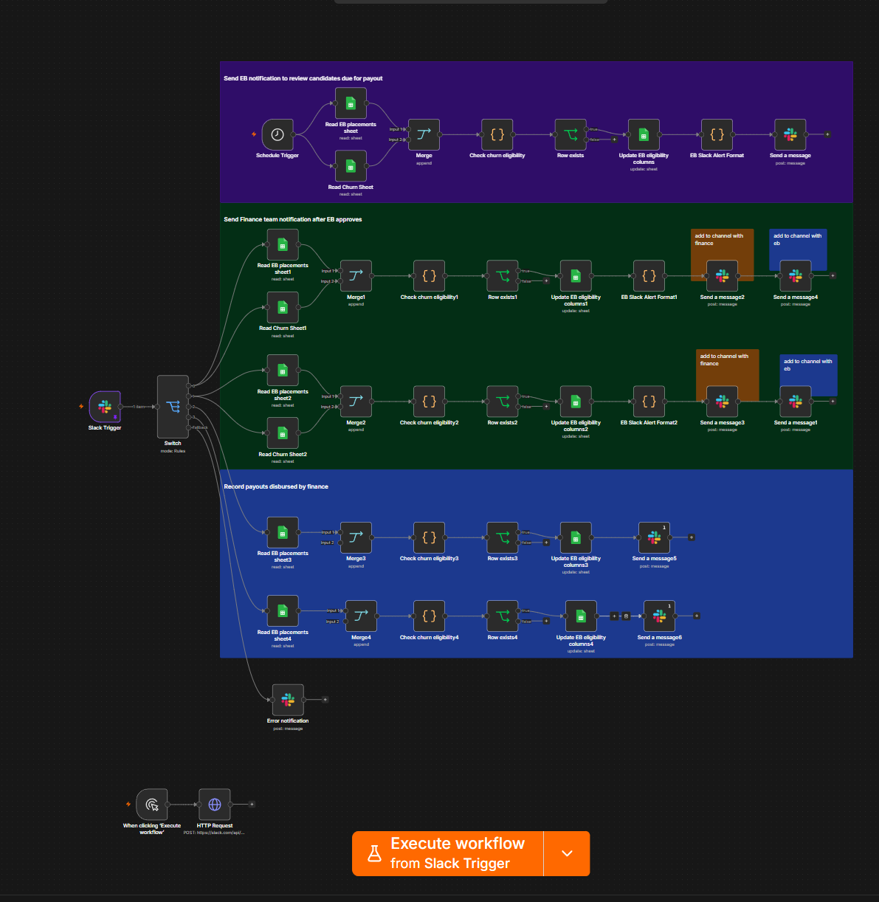

# Referral Eligibility & Payout Automation

An automated finance and eligibility workflow for reviewing referral milestones, validating eligibility, coordinating updates, and supporting payout status confirmation.

## Overview

This project covers the **finance and eligibility subsystem** of a larger referral platform. I independently designed, built, tested, improved, and maintained this subsystem, including its workflow architecture, rule evaluation, data integrations, and notifications. The surrounding referral platform was a broader system; this repository specifically documents the subsystem I owned.

The automation replaces repeated manual checks with structured, scheduled and event-driven processing. It compares referral tracking information with lifecycle status records, evaluates eligibility conditions, updates milestone status, and routes results to the relevant review or confirmation flow.

## Tech Stack

- **n8n** — workflow orchestration, scheduling, branching and integrations
- **JavaScript** — record normalization, validation and eligibility logic
- **Google Sheets** — structured tracking and source data
- **Slack** — operational triggers, status notifications and coordination

## Workflow Architecture



*Overview of the workflow structure and its eligibility, finance, and notification branches.*

### Major processing paths

1. **Scheduled eligibility checks:** Load referral milestone records and status data on a recurring schedule.
2. **Record reconciliation:** Combine sources and evaluate whether the subject and referrer meet relevant lifecycle and milestone conditions.
3. **Eligibility updates:** Route eligible, excluded, previously processed, and review-required records to the appropriate tracking actions.
4. **Event-driven review:** Respond to operational messages through separate review and finance-confirmation paths.
5. **Finance confirmation:** Validate relevant conditions before recording payout-related status changes.
6. **Notifications and exception handling:** Format updates for stakeholders and surface issues for follow-up.

## Technical Highlights

- Multi-path orchestration across scheduled and event-driven triggers
- JavaScript-based data normalization and milestone checks
- Eligibility guards for active/inactive status and repeated processing
- Conditional routing, record updates and notification formatting
- Finance-specific confirmation and tracking paths
- Troubleshooting and iterative improvement of complex workflows

## My Role & Contributions

I owned the **finance and eligibility automation** within a larger referral system.

- Designed the end-to-end workflow architecture and processing logic for the finance and eligibility subsystem.
- Personally built and configured the n8n workflow, including eligibility calculations, conditional branches, integrations and notifications.
- Led testing and QA coordination, validated workflow behavior, and addressed issues discovered during testing.
- Developed and refined the eligibility evaluation rules and safeguards for payout-related processing.
- Implemented improvements to workflow efficiency, correctness and operational reliability.
- Maintained, monitored and troubleshot the automation as requirements evolved.

## Technical Architecture JSON

See [`workflow-architecture.json`](workflow-architecture.json) for a **detailed, non-executable representation** of the workflow. It documents node purposes, n8n component types, connections, processing paths, illustrative schemas and generalized logic. It does not contain the production scripts, working endpoints or operational identifiers.

## Repository Contents

```text
referral-eligibility-automation/
├── README.md
├── workflow-architecture.json
└── assets/
    └── workflow-overview.png 
```
